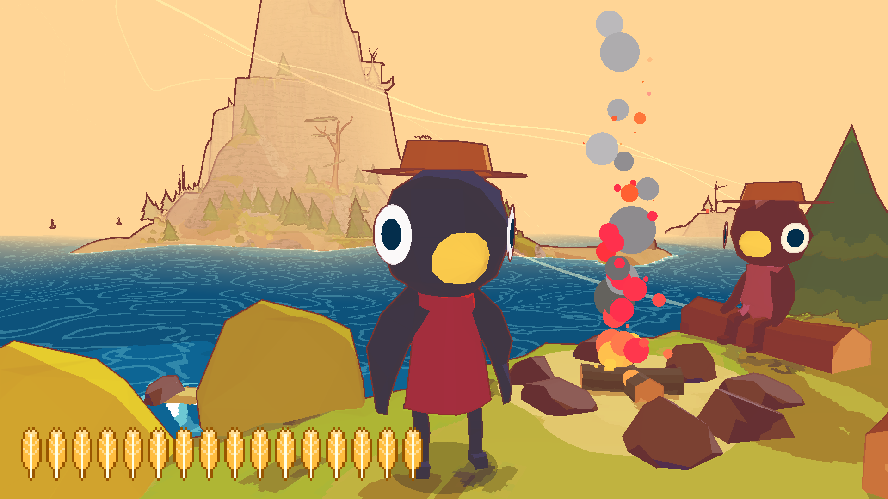

# A Short Hike – Camera Modes & 3D

A BepInEx mod for *A Short Hike* that adds player-controlled camera modes and half side-by-side stereo 3D.



## Features

- **Camera modes:** press **R3** (or **F5**) to cycle **auto → 3rd person → 1st person**.
  - **auto:** the game's original camera.
  - **3rd person:** orbit Claire with the right stick. The camera pulls in when terrain is in the way, and swings in behind your heading while you glide.
  - **1st person:** look from Claire's head with the right stick. Her model is hidden but still casts a shadow.
  - On the ground the controls are the game's own: the left stick moves relative to the camera and the right stick owns the camera. While **gliding** (your right thumb is on jump), the left stick **turns** (←/→) and the camera follows your heading. Diving works as in the game in both modes: hold the stick to glide flat, let go to dive. Climbing and the boat keep the original controls.
  - In conversations the right stick still turns the camera.
  - The game's cutscene, fishing and similar cameras still take over when needed.
- **3D (half SBS):** toggle with **options → graphics → 3d**. Each eye is a full render, so outlines and colour correction work in 3D. HUD and text appear in both eyes at screen depth. Opening screens, the title screen and menus are shown flat in both eyes.
- **Item switching:** **RB**/**LB** cycle through your items and none, without opening the pause menu.
- Mode and item changes are announced in the top-left.

## Requirements

- *A Short Hike* for Windows (tested with the Steam version).
- [BepInEx 5.4.23.2 (win x86)](https://github.com/BepInEx/BepInEx/releases/tag/v5.4.23.2), included in the `-with-BepInEx` download.

## Install

1. Download `ShortHikeCamera-<version>-with-BepInEx.zip`.
2. Extract it into the game folder, the one with `AShortHike.exe` in it. On Steam: right-click the game → **Manage** → **Browse local files**.
3. Start the game. Press **R3** (or **F5**) to switch camera.

The ZIP contains the mod, BepInEx and a `BepInEx\config\BepInEx.cfg` with the one setting the game needs (`HideManagerGameObject = true`).

**Already have BepInEx 5?** Download `ShortHikeCamera-<version>.zip` (mod only) instead and extract it into the game folder. Make sure `HideManagerGameObject = true` is set in your `BepInEx\config\BepInEx.cfg`.

## Updating

Extract the new mod-only `ShortHikeCamera-<version>.zip` into the game folder and overwrite. Your settings are kept. If you installed an earlier version by copying `ShortHikeCamera.dll` straight into `BepInEx\plugins\`, delete that copy.

## Settings

`BepInEx\config\local.ashorthike.cameramodes.cfg` (reloaded live while the game runs).

| Section | Setting | Default | |
|---|---|---|---|
| Controls | `CycleKey` | F5 | Keyboard key for cycling modes |
| Controls | `YawSpeed` / `PitchSpeed` | 180 / 120 | Look speed (°/s) |
| Controls | `InvertY` | false | |
| Controls | `Steering` | Auto | `Auto`: Turn while gliding, Strafe otherwise. `Turn`: left stick ←/→ turns, ↑/↓ moves. `Strafe`: original camera-relative movement |
| Controls | `TurnSpeed` | 75 | Turn rate (°/s) |
| Controls | `ItemSwitching` | true | RB/LB cycle items (replaces LB put-away/drop) |
| Controls | `GlideDiveCameraPitch` | 30 | Extra camera tilt at a full dive, 3rd person (°) |
| General | `BlendTime` | 1 | Seconds to blend between the game's cameras and the mod's (entering 3rd person, leaving 1st person; 0 = instant) |
| ThirdPerson | `Distance` | 10 | Camera distance |
| ThirdPerson | `PivotHeight` | 2.2 | Orbit point height above feet |
| ThirdPerson | `FieldOfView` | 50 | |
| ThirdPerson | `GlideFollowSpeed` | 120 | While gliding, max rate the camera swings in behind your heading (°/s) |
| ThirdPerson | `GlideCameraPitch` | 15 | Camera pitch eased to while gliding |
| FirstPerson | `EyeHeightOffset` | 0 | Added to Claire's eye level (negative = lower) |
| FirstPerson | `FieldOfView` | 70 | |
| FirstPerson | `HidePlayerModel` | true | |
| FirstPerson | `TransitionTime` | 1 | Seconds to move in from 3rd to 1st person (0 = instant) |
| Stereo3D | `Mode` | Off | `Off` / `HalfSBS` |
| Stereo3D | `EyeSeparation` | 0.1 | Higher = stronger 3D |
| Stereo3D | `Convergence` | 10 | Distance at screen depth |
| Stereo3D | `SwapEyes` | false | Use if depth looks inverted |
| Stereo3D | `FlipMenus` | false | Use if the title screen / menus appear upside down in 3D |

## Build

Requires the .NET SDK. `GamePath` in `ShortHikeCamera.csproj` must point to your install.

```
dotnet build -c Release
```

This builds the plugin and copies it into the game's `BepInEx\plugins` folder. Release builds also put both release ZIPs in `dist\`. The `-with-BepInEx` ZIP is made from the BepInEx build pinned in the `.csproj` (downloaded once and checked against its SHA-256 hash) plus the files in `packaging\`.

## Known limitations

- Some interiors only hide their roof when the game's own camera is active, so use auto there.
- In 3D the mouse cursor doesn't line up with menus. Use a controller.
- Keyboard/mouse look is tuned for a gamepad stick.

## Uninstall

Delete the `BepInEx\plugins\ShortHikeCamera` folder. To remove BepInEx as well, delete `winhttp.dll`, `doorstop_config.ini`, `.doorstop_version`, `changelog.txt` and the `BepInEx` folder from the game folder.

## Licenses

The `-with-BepInEx` download includes an unmodified copy of BepInEx and the libraries it ships with. Their licenses and source links are in `BepInEx\licenses\` (see `THIRD-PARTY-NOTICES.txt` there).
